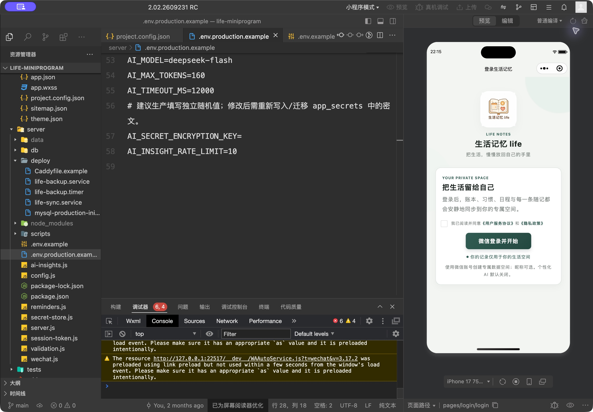

# 生活记忆 life：产品、交互与流畅性优化方案

日期：2026-10-27。代码基线：`28efddc`，工作区审查前干净。本次只新增分析材料，没有修改业务实现。

## 1. 结论与证据范围

当前产品已有较完整的个人生活记录能力。下一阶段应集中在：**让记录可靠保存，让高频操作一步直达，让记录产生可执行的回顾价值。**

建议优先顺序：数据可信 → 高频路径 → 信息层级 → 性能治理 → 留存与跨模块联动。

本方案区分三类证据：

- **本轮界面观察**：微信开发者工具中的登录首屏，截图已保存并重新打开检查；没有完成登录后的视觉走查。
- **当前源码与隔离复现**：14 个页面路由、9 个同步集合、页面生命周期、同步/缓存/提醒/备份；使用真实模块和合成数据复现了 7 类问题，结果见 [source-probes.json](source-probes.json)。wx 接口使用内存 mock，未操作个人业务数据。
- **产品建议与验收目标**：以下页面重排、功能优先级、性能数字均为提案，不代表当前性能测量或用户调研结论。

开发者工具打开当前项目后提示工具登录态缺失，模拟器停在应用登录页。截图中控制台的 `access_token missing` 是开发工具环境的现象，不能据此判定线上小程序登录失败。未代用户勾选协议、建立账号或绕过登录，因此无法完成核心流程截图审查。

### 本轮流程覆盖

| 步骤 | 用户任务 | 当前判断 | 证据与限制 |
|---|---|---|---|
| 1 | 首次进入、登录 | 首屏主按钮清晰，隐私说明可见；登录完成未验证 | 本轮截图；未完成工具登录与应用协议流程 |
| 2 | 今日 → 记账/日程/体重 | 入口文案承诺直接记录，实际先进入模块 | 当前导航函数；未实测点击耗时 |
| 3 | 录入 → 保存 → 同步 | 已有乐观更新和重试；状态表达与退出保护存在缺口 | 源码、隔离复现、引擎测试 |
| 4 | 写随记 → 保存/返回 | 有草稿，存在定时器与离开页面的时序问题 | 隔离复现；无真机键盘测试 |
| 5 | 日常打卡 → 历史/补录 | 功能已齐；小格子的直接点击体验需完善 | WXML/WXSS；无触屏测量 |
| 6 | 开启提醒 → 等待送达 | 习惯/还款提醒已实现；开启意图和送达能力表达混杂 | 客户端与 worker 源码、测试；无真实微信送达证据 |
| 7 | 搜索/复盘 → 找回记录或调整计划 | 聚合能力已具备；搜索范围、深链和后续行动仍可完善 | 当前页面实现；未完成截图走查 |
| 8 | 导出/恢复/退出 | 导入预览与合并已有；剪贴板交付、退出缓存处理有改进空间 | 源码与隔离复现 |

### 唯一已接受的界面截图

步骤 1 的优点是品牌、主按钮、协议与 AI 默认关闭说明均可见。需验证小屏与大字体下是否仍可操作；首屏英文装饰和两层介绍文案可精简，以更快说明“能帮我记录什么”。截图不足以证明读屏支持、文字对比度全面达标或后续流程可用。

## 2. 已具备的能力，不重复立项

9 月竞品报告中的部分结论已过时，应以当前实现重新排期。

| 能力 | 当前实现 | 后续应完善的方向 |
|---|---|---|
| 分类自定义 | 收藏、隐藏、自定义、改名/删除已经存在 | 分类预算覆盖、自定义排序、历史改名口径 |
| 导出与恢复 | 自有 JSON 备份、合并导入预览、账本 CSV 已存在 | 文件交付、恢复语义、外部账单映射 |
| 习惯历史 | 12 周热力图、补录、目标快照已经存在 | 触控、频率、暂停与历史解释 |
| 日程重复 | 单次、每天、每周、工作日、每月已存在 | 单次修改范围、自选星期、短月策略 |
| 记账月历 | 已有月历与按日流水 | 日期/账户/分类组合筛选、明细下钻 |
| 深色模式 | 五套具体配色，另有跟随系统 | 辅助文字对比度、图表与原生控件一致性 |
| 提醒矩阵 | 单次日程、习惯与还款提醒已存在 | 授权/额度/失败/下一次提醒的统一状态 |
| 性能基础 | 懒加载、按压态、部分列表分批、搜索防抖已存在 | 隐藏页刷新、全量计算、缓存增长与真机基线 |

对应实现主要位于 `category-utils.js`、`backup.js`、`habit-utils.js`、`plan-utils.js`、`reminder-client.js`、`theme.js` 和各页面。README 仍以 v2.10 描述当前版本，FEATURES 中也有旧说明残留，建议随下一版一起校准，避免重复开发和验收口径错位。

## 3. 优先修复：用户对数据的信任

P0：可能漏数据、丢未同步内容或错误宣称已同步；P1：主要任务受阻或体验明显不一致；P2：在基础流程稳定后增强。

### R01 · P0 · 退出前保护未同步与被拒写入

**已复现**：队列有 1 条未同步写入，调用“退出”并确认后，`store.resetLocal()` 将队列清成 0。现有确认文案只说“本机缓存会清除，云端数据不会删除”，没有说明本机独有内容会失去。被拒写入也会被清空。

- 方案：退出前检查 queue、rejectedWrites、persistError；提供“同步后退出”“导出本机副本”“取消”。未确认安全处置前不清除唯一副本。中断网络时仍能导出。
- 账号缓存按身份隔离；会话失效后同身份重新登录应保留待提交内容。
- 验收：离线新增/修改/删除 → 尝试退出 → 取消、恢复网络或导出，各条记录均可核对；被拒写入同样覆盖。
- 位置：[mine.js](../../miniprogram/pages/mine/mine.js#L552)、[store.js](../../miniprogram/utils/store.js#L235)。

### R02 · P0 · 保存、待同步和已同步使用同一套状态

**已复现**：`syncState='idle'` 且 queue=1 时，“我的”仍显示“已安全同步”；今日页也仅依据 syncing/offline 显示“已同步”。`sync.pull()` 成功先回到 idle，再异步 flush；一次拉取成功不能说明所有本机写入已被接受。

- 方案：统一派生状态，优先级为“保存失败 / 云端拒绝 → 待同步 N 条 → 同步中 → 已同步”。有本地持久化错误时不能承诺“已暂存本机”。
- 行级提示区分“已保存到本机”和“云端已确认”；默认使用轻提示，只对需要用户处理的错误持续显示。
- 验收：新增后等待冲刷、断网、422、401、缓存写失败、重新登录等状态下，首页、详情与“我的”表述一致。
- 位置：[mine.js](../../miniprogram/pages/mine/mine.js#L25)、[today.wxml](../../miniprogram/pages/today/today.wxml)、[sync.js](../../miniprogram/utils/sync.js)。

### R03 · P0 · 下载游标不能被本机写入推进

**已隔离复现**：设备上次读取到时间 1000；云端另一条记录时间 1500，尚未拉取；本机新增一条时间 2000，`applyLocalUpsert()` 立即把 since 推到 2000。后续 `getChanges(2000)` 不再返回 1500 的记录。MySQL 同样使用 `updated_at > since` 条件。用户表现会是“另一台设备的内容怎么少了”。

- 方案：服务端使用单调变更序号作为下载游标，与客户端业务时间、冲突版本分离；下载完整批次后提交游标。本机编辑不修改下载游标。
- 不能只改成“使用 serverTime”：设备时钟偏差、延迟上传旧时间戳、同毫秒并发仍需要一致的排序与版本设计。
- 旧客户端迁移需要版本协商与一次完整补拉，保留未同步队列并验证去重。
- 验收：双设备交错写、离线后补传、设备时钟快/慢、同毫秒记录、删除墓碑、分页中断重试均不漏不重。
- 位置：[store.js](../../miniprogram/utils/store.js#L152)、[mysql-store.js](../../server/db/mysql-store.js#L195)。

### R04 · P1 · 表单草稿与后台刷新隔离

**已复现**：预算原值 3000，用户输入 4500 后再次调用 render，输入回到 3000。页面全局订阅数据变更，故后台同步或其他记录变化也可能触发这个覆盖。

- 方案：已保存数据与编辑草稿分开；表单有修改后，后台刷新只更新只读区域。并发修改时说明“其他设备已更新”，允许比较和选择。
- 所有长表单关闭时，按是否修改提供“保留草稿 / 放弃”；空表单直接关闭，不增加无意义确认。
- 验收：输入过程中收到同步、切主题、切前后台、拉取失败，文字与光标不丢失。
- 位置：[mine.js](../../miniprogram/pages/mine/mine.js#L186)。

### R05 · P1 · 修复随记草稿的保存时序

**已复现两种情况**：输入后立即保存，350ms 草稿定时器仍运行，已清掉的草稿重新出现；输入后在 350ms 内卸载页面，onUnload 直接取消定时器，最后一段内容没有写入草稿。

- 方案：保存成功前取消草稿定时器再清理；关闭、返回、onHide/onUnload 时同步提交最后一份草稿；草稿写失败明确提示。保留内容时间和更新时间，避免把陈旧草稿当成当前记录。
- 验收：输入后 0/100/300/500ms 保存或返回，重复打开不出现已保存的旧草稿，未保存的新文字可恢复。
- 位置：[memory.js](../../miniprogram/pages/memory/memory.js#L96)、[memory.js](../../miniprogram/pages/memory/memory.js#L211)。

### R06 · P1 · 缓存增长需要结构性处理

**源码风险，尚未模拟平台实际超限**：9 个集合和写队列集中在一个 key；超阈值只删除旧墓碑。活跃记录自身增长时，重建后全量拉回同样的数据，不能解决容量根因。落盘还有 250ms 防抖，App.onHide 没有补落盘。

- 方案：独立、可靠地持久化写队列；记录按集合/时间分片，使用版本化快照与校验恢复。先保证崩溃和切后台不会丢刚写的内容，再考虑历史按需加载。
- 重建缓存采用“新快照拉取校验完成后切换”，避免失败后先把用户页面清空；待同步数据需叠加回新快照。
- 验收：达到项目缓存阈值、模拟写失败、后台杀进程、重建中断、网络恢复后，未同步记录和历史均可核对。
- 位置：[store.js](../../miniprogram/utils/store.js#L83)、[app.js](../../miniprogram/app.js)。

### R07 · P1 · 退出与删除的本机清理范围一致

**已复现**：退出后随记草稿和搜索历史仍存在，本轮没有证明它们会跨微信身份泄露。当前文案“本机缓存会清除”与实际范围不一致。

- 方案：列明本机内容类别；普通退出可按用户选择清理草稿，永久删除应清除对应身份的草稿、搜索历史和临时深链。不要误清其他身份的待同步副本。
- 验收：退出、删除、会话失效三条路径分别验证；清理范围与产品说明一致。
- 位置：[api.js](../../miniprogram/utils/api.js#L41)、[memory-utils.js](../../miniprogram/utils/memory-utils.js#L104)、[search.js](../../miniprogram/pages/search/search.js)。

## 4. 交互与功能设计：把每天的操作变短

| ID / 优先级 | 现状与影响 | 优化方案 | 验收目标 |
|---|---|---|---|
| U01 / P1 快捷记录 | 今日“记一笔/排日程/记体重/待买物品”只跳模块；随记已有 compose=1 | 入口携带 create 意图；Tab 页使用一次性 pending action，普通浏览和新增分开；记账打开即聚焦金额 | 从今日点击一次即进入对应表单，保存后可继续记录或回原位置 |
| U02 / P1 首页层级 | 主视觉、随记、快捷入口、今日收支、本月支出、待处理、最近记录、轻提醒依次展开；行动区较靠后 | 推荐顺序：日期和真实状态 → 主记录入口 → 当前一件事/今日待处理 → 精简收支预算 → 最近记录；低频内容折叠，允许选择常用模块 | 在 375×812 逻辑尺寸上，无需长滚动即可记录和处理当前任务；首次引导只推荐一件可完成的小事 |
| U03 / P1 “我的”职责 | 数据状态、主题、预算、八个生活工具、邀请、隐私、账号混合；预算还有多行输入 | 预算放回记账；主题收成一行入口；工具增加收藏或独立集合入口；“我的”保留账号、设置、数据控制；AI 开关仍可见 | 高频业务不依赖滚到“我的”下半页；数据与隐私入口易发现 |
| U04 / P1 记账布局 | 模板中完整资产/账户列表位于月收支与流水之前；账户多时挤压流水 | 主界面突出月收支和流水；资产概览折叠/独立查看；金额、常用分类、上次账户前置，其他字段渐进展开 | 典型记账在预设测试场景中约 10 秒内完成；一屏优先看见近期流水，账户数增长不挤掉主任务 |
| U05 / P1 预算与分类 | 分类已自定义，但预算编辑仍固定餐饮/交通/娱乐休闲/居家用品/医疗健康五项 | 预算分类直接来自支出分类配置；支持选择任意自定义分类；明确隐藏、改名是否迁移预算与历史 | 用户新增“宠物”后可直接设预算；改名/隐藏不造成预算静默丢失或双计 |
| U06 / P1 提醒状态 | 习惯订阅被拒或服务不可用仍保存 enabled=true；capEnabled=false 时无续订横幅 | 区分“希望提醒”与“可送达”；显示未授权、待联网确认、额度用完、模板不可用、已安排、发送失败；统一入口管理、业务页直达 | 拒绝授权后明确显示当前不能提醒；每种失败都有可执行下一步，不只给瞬时 toast |
| U07 / P1 搜索完整性 | 全部仅含随记/日程/待买/书影音/账本；超过 100 条只显示最近 100，无继续入口；习惯最近记录只跳习惯主页 | 范围明确标识，补习惯/体重检索或显式范围选择；结果分批加载；按日期/模块筛选；深链定位记录与具体发生日 | 第 101 条也能找回；进入编辑返回后保留关键词、筛选与滚动位置 |
| U08 / P1 防误完成 | 今日待处理点击整行即可完成，和“最近记录”整行进入详情的语义不同 | 独立完成按钮；标题进入详情；完成提供撤销；连续计数保留连点语义，动画不作为真实写入的前置条件 | 查看任务不意外完成；误完成在当前上下文可撤销；快速连点计数准确 |
| U09 / P1 触控与可读性 | 历史格子宽高 22rpx，直接点格补录；部分标签 20rpx；多处 view 充当按钮 | 热力图用于概览，点周/月进入放大日历，保留显式“补录”；主要热区以 44×44 逻辑像素为设计目标；补朗读标签、选中/禁用状态，图表附文字摘要 | 在小屏/大字体、单手和 VoiceOver/TalkBack 下完成主要任务；不只依靠颜色传达状态 |
| U10 / P1 数据交付 | JSON 与 CSV 都交付到剪贴板；“导入恢复”实际不恢复同 ID 墓碑 | 保留复制入口，并评估本地文件导出/用户主动选择文件导入；不新增用户媒体上传服务。改名为“合并缺失记录”，预览分别解释跳过原因 | 用户能保存独立备份并完成一次空空间恢复演练；误删恢复另行设计，不能误称当前可撤销所有删除 |
| U11 / P2 日程编辑 | 重复日程修改作用于整个系列，单次只支持完成/跳过；缺少备注/子步骤 | 优先补备注、清晰的“仅这次/整个系列”修改范围，再考虑子步骤和自选星期；短月跳过策略在选择月重复时立即说明 | 单次改时间不改变其他发生日；月末、跨年、结束日期结果可预览 |
| U12 / P2 习惯弹性 | 习惯以每日目标为主；连续天数承担主要反馈 | 自选星期/每周 N 次、暂停、休息日；优先展示周期完成率；区分补录与当天记录，保留目标历史 | 休息日不算失败，暂停不生成逾期，历史目标修改不改写过去成绩 |
| U13 / P2 回顾闭环 | 周/月报偏统计与总结，用户看完后缺少轻量行动 | 增加“本周一个发现/下周一个调整”，可手动转为日程或习惯；待买完成可选择记账，确认实际金额并关联来源去重 | 每个建议可解释、可忽略；不会自动改预算、自动记账或制造重复任务 |
| U14 / P2 生活指数解释 | 分数由固定 45 基础分、习惯 35、日程 20 组成，未覆盖完整生活 | 改称“今日记录进度”或给出计算口径；允许隐藏，不把少记录等同于生活质量低 | 首次无数据显示可开始的行动；用户能理解分数、无评分压力 |

保留目前的克制视觉与隐私取向。当前优先优化布局、主次、热区、错误恢复，不需要全量更换视觉风格。

### 已计算的颜色风险

按当前主题 token，辅助文字 `--ink-2` 放在卡片 `--card` 上的理论对比度：雾林 4.02、暖纸 4.34、月白 4.08、暮紫 4.46、夜间 5.18。前四种低于普通文字 4.5:1 的参考值。这里只检查了颜色对，不代表所有控件的实际背景都相同，也不是完整合规结论。

建议调深浅色主题的辅助文字，同时检查 placeholder、标签、图表轴文字与 disabled 状态。普通文字 4.5:1 与大字 3:1 参照 [W3C 对比度说明](https://www.w3.org/WAI/WCAG22/Understanding/contrast-minimum.html)。小目标应有足够尺寸或间距，参照 [W3C 目标尺寸说明](https://www.w3.org/WAI/WCAG22/Understanding/target-size-minimum.html)；44×44 是本方案更宽松的触屏设计目标，不应机械换算为 44rpx。

## 5. 流畅性方案：先量化，再针对瓶颈优化

当前没有本轮真机帧率、启动耗时和触控时延数据，不能宣称产品整体卡顿或优化后快了多少。源码能确认的是存在重复和无关工作：

1. `store.notify()` 广播所有订阅，页面多在 onLoad 订阅、onUnload 取消，未在 onHide 停止；已保留的 Tab/页面可能参与无关更新。
2. today 在 onLoad/onShow 都 render，每次多次遍历集合并排序最近记录；syncState 的变化也触发相同聚合。
3. 列表分批主要控制渲染载荷，未消除全量计算；“加载更多”后仍重新构建已显示内容。
4. 随记局部搜索每次输入立即过滤、分组和统计；统一搜索已有 300ms 防抖，两处策略不一致。
5. 待买页仍全量下发已买/待买数组；记账按 10 天分组分页，单日记录特别多时首批仍可能很大。

### 执行顺序

| 阶段 | 做法 | 约束 |
|---|---|---|
| 建立基线 | 固定页面、数据量、机型和网络；采集点击到反馈、setData 次数/载荷/回调耗时、JS 长任务、冷/热启动 | setData 回调不等于屏幕绘制完成；模拟器与真机分别记录 |
| 减少无关计算 | 按集合/变更类型订阅；隐藏页标记 dirty，在 onShow 合并刷新；同步状态只更新状态区域 | 保证切回页面后展示最新记录，不能因缓存造成账本不一致 |
| 缓存派生结果 | 给集合版本号；缓存月汇总、习惯统计、最近记录；统一页面首次 render 入口 | 依赖可追踪，避免散落缓存失效条件 |
| 减少传输与节点 | 按行数分页、批次追加、变化字段路径更新；图表局部刷新；长列表达到实测阈值后再评估窗口化 | 已有批渲染保留，不直接引入重型图表库或切渲染框架 |
| 批量与落盘 | 合并一次业务操作内的通知；批处理跨帧让出执行；待写队列可靠落盘 | 不以延长写入防抖牺牲数据可靠性 |

### 建议验收指标（待基线后校准）

- 热态下，点按到可感知反馈 p95 ≤100ms；已加载页面的本地保存反馈 p95 ≤200ms。
- 一次本地变更不触发无关隐藏页面 setData；前台同一业务变化尽量合并成一次视图提交。
- 一般操作避免超过 50ms 的单段 JS 长任务；长列表滚动目标稳定接近设备刷新率，记录慢帧分布。
- 测试规模分开设置：日常规模、项目缓存阈值附近、迁移后的多年数据规模。超出当前容量的数据只能作为容量压力测试，不能标为已支持。
- 样本至少含 iOS 与中低端 Android，各覆盖冷启动、首次同步、连续记账、快速打卡、历史搜索、键盘弹起、前后台切换。
- 性能记录仅保存操作名、耗时、条数、载荷大小；不采集金额、随记正文或身份信息。默认本机调试，不改变现有隐私政策。

## 6. 分阶段交付与依赖

以下为一名熟悉项目的全栈开发的粗略人日，不是承诺工期；完整真机验收、微信后台配置及发布等待另计。游标/缓存迁移需单独设计和回归，不宜和首页改版混在同一批发布。

| 交付批次 | 范围 | 粗估 | 发布门槛 |
|---|---|---|---|
| A · 记录可信 | R01/R02/R04/R05/R07，统一异常恢复；补行为测试 | 4–6 人日 | 离线、拒写、退出、编辑与草稿的复现用例全部转绿 |
| B · 同步与容量 | R03/R06，协议版本、游标迁移、可靠队列、分片快照 | 6–10 人日 | 双设备、时钟偏差、迁移中断、容量边界和进程重启验证完成 |
| C · 每天顺手 | U01–U06/U08/U09，快捷直达、首页/记账/我的收纳、提醒状态、触控与配色 | 6–9 人日 | 核心路径减少跳转；真机表单、键盘和安全区检查通过；提醒实际送达/拒绝/额度耗尽均有证据 |
| D · 找回与复盘 | U07/U10/U13，搜索可继续加载、数据文件交付、可执行复盘 | 4–7 人日 | 搜索完整性、备份恢复演练、关联去重通过 |
| 后续候选 | U11/U12/U14；专注计时等新能力 | 验证需求后估算 | 有明确高频场景与使用反馈再立项 |

性能基线从 A 批开始采集，无关刷新治理可随 C 批交付。建议每批有独立检查表、变更记录和可回退候选。

近期不建议投入社区、排行榜、大量徽章、原生壳或系统级自动记账；先把个人“记录 → 找回 → 回顾 → 再行动”做稳。专注计时属于候选扩展，需要先明确小程序前后台场景，不应把持续后台运行作为既定能力承诺。

## 7. 验证记录与下一轮走查清单

### 本轮自动验证

- 仓库 68 个 `tests/*.test.js` 脚本均已获得通过结果。
- 首次全量执行：67 通过，engine 因本机 8787 未启动而健康检查超时；随后按 CI 方式启动回环监听、临时目录 file 存储、DEV 登录的隔离服务，重跑 engine 通过。测试服务已停止。
- 这不是生产 MySQL、体验版、真实微信登录、订阅消息送达或真机性能证明。
- 额外 7 类问题使用真实源码模块、内存 wx mock 与合成数据复现；它们说明现有测试仍有覆盖缺口。详见 [source-probes.json](source-probes.json)。

### 后续验收必须走完的任务

1. 新用户登录 → 跳过昵称 → 完成第一笔记录；既有会话、失效会话、弱网重试分别检查。
2. 首页快捷记账 → 键盘输入 → 保存 → 连续下一笔 → 返回原页面；核对本机、云端确认与重启读回。
3. 习惯快速连续 +1 → 修正 → 历史补录 → 休息/暂停；核对计数与目标历史。
4. 单次/重复日程 → 编辑范围 → 完成/跳过/撤销 → 到期提醒；验证拒绝授权、失败、额度耗尽。
5. 随记输入即返回/切后台/保存 → 再打开；确认最新文字恢复且已保存内容不重新成为草稿。
6. 两设备并发编辑、离线再联网、时钟偏差、重新安装/登录；核对无漏拉、无串号、无重复。
7. 搜索大量同关键词结果 → 找到第 101 条 → 打开 → 返回，筛选和位置保持。
8. JSON/CSV 导出 → 保存在用户可管理的位置 → 空空间导入 → 核对数量、金额、墓碑、关联与跳过原因。
9. 缓存阈值、写失败、重建断网、退出未同步提示和永久删除本机清理范围。
10. iOS/Android、小屏、大字体、深浅主题、读屏、键盘遮挡、底部安全区；记录截图与实际操作结果。

试用阶段建议先让 5–8 位目标用户完成统一任务，记录任务成功率、用时、误触与放弃原因。留存、提醒续订率和周复盘使用率需有真实使用样本后才能设增长目标；若采集统计，先限定不含内容的最小字段并由用户知情选择。
